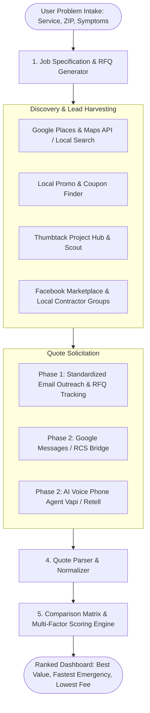

# BestQuoteFinder 🛠️⚡

> Automated Multi-Channel Service Discovery, Outreach & Quote Comparison Engine.

When a home appliance breaks (e.g. *water heater stopped working*), finding the best contractor traditionally requires manually searching Google Maps, creating Thumbtack projects, browsing Facebook Marketplace & Groups, checking for coupons, emailing or calling 5+ contractors, and comparing confusing estimates.

**BestQuoteFinder** automates this entire pipeline in structured phases while keeping all personal credentials, session tokens, and passwords secure and isolated from Git.

---

## 🗺️ System Workflow Diagram



*A high-resolution vector diagram is also committed in [`docs/workflow.svg`](docs/workflow.svg).*

---

## 🔒 Security & Git Credentials Policy

This project is built to be safely committed to GitHub without ever leaking your credentials or API keys.

1. **Zero Hardcoded Secrets**: All passwords, API keys, and session cookies are loaded exclusively from `.env`.
2. **Strict `.gitignore`**: `.env`, `*.db`, session states, and authentication caches are strictly ignored and will never be committed.
3. **Template Provided**: See [`.env.example`](.env.example) for the list of required variables and setup instructions.

---

## 🚀 Phases Roadmap

### Phase 1 (Active)
- **Job Intake & Standardized RFQ Generator**: Formats service requirements into high-converting RFQs with tracking IDs (`[RFQ-XXXXX]`).
- **Multi-Source Discovery & Promo Scout**:
  - Google Places & Local Maps directory
  - Automatic promotion / coupon scanning (e.g., *"$45 off diagnostic"*, *"10% new customer"*)
  - Curated 1-click deep-search links for Thumbtack and Facebook Marketplace
- **Email Outreach Engine**:
  - Direct SMTP delivery via Gmail App Password / SendGrid
  - 1-click `mailto:` launch for instant desktop/web email client dispatch
- **Quote Ingestion & Heuristic Parser**:
  - Ingests quotes from email replies or pasted text
  - Extracts Diagnostic Fee, Credited toward repair (Yes/No), Estimated Total, Arrival Window, and Warranty terms
- **Comparison & Reasoning Matrix Dashboard**:
  - Multi-metric weighted scoring (Cost, Speed, Reputation, Warranty)
  - Decision badges: 🏆 *Best Overall Value*, ⚡ *Fastest Response*, 💰 *Lowest Diagnostic Fee*

### Phase 2 (Coming Soon)
- **Google Messages / RCS Pairing**: Connects to your paired Google Messages web bridge (similar to WhatsApp Web pairing) for instant contractor texting.
- **AI Voice Agent (Vapi / Retell AI)**: Hands-free phone calling assistant to auto-dial phone-only contractors, ask standard diagnostic questions, and record transcripts.

---

## 📦 Quick Start & Installation

### Prerequisites
- [Node.js](https://nodejs.org/) (v18 or higher)
- [Git](https://git-scm.com/)

### 1. Clone & Configure Environment
```bash
git clone <your-github-repo-url> BestQuoteFinder
cd BestQuoteFinder

# Copy environment template
cp .env.example .env
```

Edit `.env` to configure your email settings (e.g., Gmail App Password) or optional Google Places API key.

### 2. Install Dependencies
```bash
npm run install:all
```

### 3. Run Development Server
```bash
npm run dev
```

- **Frontend Dashboard:** [http://localhost:5173](http://localhost:5173)
- **Backend API:** [http://localhost:3001](http://localhost:3001)

---

## 📂 Project Structure

```
BestQuoteFinder/
├── .env.example              # Clean configuration template (no secrets)
├── .gitignore                # Protects .env, sqlite/json databases, and session caches
├── README.md                 # Project overview and Mermaid workflow diagram
├── docs/
│   ├── architecture.md       # Detailed technical architecture & security rules
│   └── workflow.svg          # Visual workflow SVG diagram
├── package.json              # Monorepo orchestration scripts
├── server/                   # Backend Express API
│   ├── config.js             # Environment loader & credential validator
│   ├── db.js                 # Safe local data persistence
│   ├── services/
│   │   ├── discoveryService.js # Google Places & Local Coupon Scout
│   │   ├── emailService.js     # RFQ generation & Nodemailer dispatch
│   │   ├── quoteParser.js      # Quote extraction & normalization
│   │   └── scoringEngine.js    # Multi-factor ranking & recommendation
│   └── index.js              # Server routes
└── client/                   # Vite + React + Tailwind CSS Dashboard
    ├── src/
    │   ├── App.jsx           # Main state & tabs
    │   └── components/       # Intake, Discovery, Outreach, & Matrix components
    └── index.html
```

---

## 📄 License
MIT
