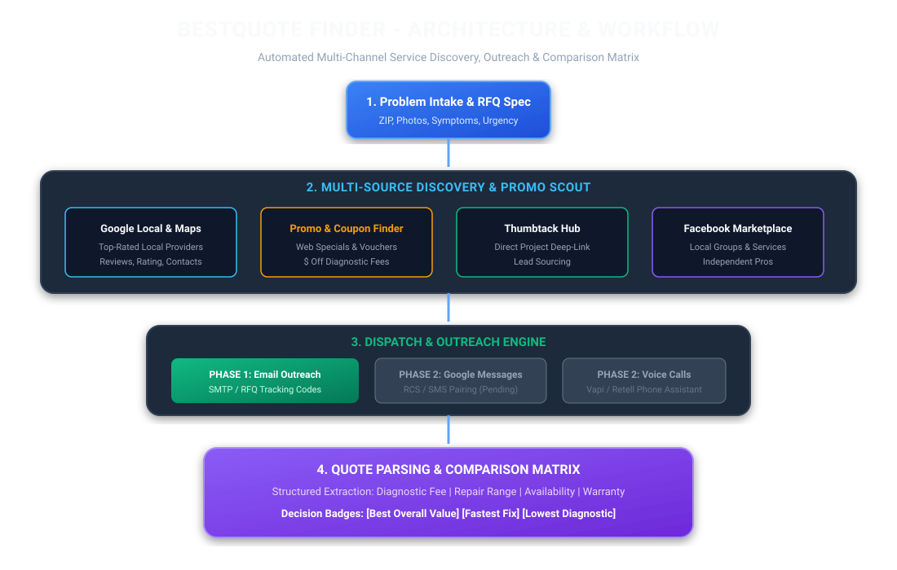

# BestQuoteFinder - System Architecture & Security Guidelines

## 1. Overview
**BestQuoteFinder** is an intelligent service procurement and quote comparison system designed to automate searching, reaching out to local service contractors, collecting proposals, and ranking them through a multi-factor comparison matrix.

---

## 2. Security & Credentials Policy (Strict Git Hygiene)

Because this project integrates with private accounts (Email, Google, Facebook Marketplace, and Thumbtack), **no secrets or credentials are ever stored in the code repository.**

### Security Rules:
1. **Environment Variables Only**: All keys, passwords, and tokens are read exclusively from `.env`.
2. **Git Exclusion**: `.env`, `*.db`, session tokens, and local cache files are strictly blocked in `.gitignore`.
3. **Template Provided**: `.env.example` documents every variable required without exposing private data.
4. **Third-Party Account Pairing**:
   - **Google / Email**: Configured via standard SMTP app passwords or OAuth2 client IDs.
   - **Facebook & Thumbtack**: Scraper/session cookies or API tokens are loaded dynamically from environment files.
   - **Phase 2 Messaging**: Google Messages / WhatsApp pairing tokens remain local to the runtime host.

---

## 3. Workflow Pipeline

### Stage 1: Problem Intake & RFQ Generator
- Accepts job category (e.g. Water Heater, Plumbing, HVAC), ZIP code, symptoms, unit details (make/model/fuel), urgency, and attachments.
- Formulates a standardized Request for Quote (RFQ) that asks the critical contractor questions:
  1. Diagnostic / dispatch fee amount?
  2. Is the diagnostic fee waived or credited towards the repair if hired?
  3. Earliest arrival window?
  4. Parts and labor warranty duration?

### Stage 2: Multi-Source Discovery Scout
- **Google Local / Maps**: Identifies top-reviewed local contractors within the service radius.
- **Promo & Coupon Detector**: Scans contractor pages and local promotion indices for web coupons (e.g., "$50 off water heater installation", "$29 diagnostic special").
- **Thumbtack Hub**: Auto-generates exact category & location search queries to surface instant-book contractors.
- **Facebook Marketplace**: Generates location-filtered contractor queries to find independent certified pros.

### Stage 3: Outreach & Dispatch Engine
- **Phase 1 (Active)**:
  - Automated or 1-click email dispatch via Nodemailer / SMTP.
  - Unique RFQ tracking code (`[RFQ-XXXXX]`) embedded in the subject line to link incoming replies.
- **Phase 2 (Roadmap)**:
  - Google Messages / RCS pairing (similar to WhatsApp web bridge).
  - Voice bot calls (via Vapi / Retell AI / Twilio) for contractors that only accept phone calls.

### Stage 4: Quote Ingestion & Parsing
- Ingests quotes received via email replies or manual paste.
- Normalizes disparate proposals into structured fields:
  - Diagnostic Fee ($)
  - Diagnostic Credited to Repair (Yes/No)
  - Estimated Repair Cost Range ($)
  - Earliest Availability (Date & Time Window)
  - Warranty (Parts / Labor)
  - Active Discounts Applied ($)

### Stage 5: Comparison & Reasoning Engine
- Calculates weighted multi-factor scores:
  - **Cost Score** (Lowest out-of-pocket & transparent pricing)
  - **Speed Score** (Fastest arrival window)
  - **Reputation Score** (Google rating & review count)
  - **Guarantee Score** (Warranty length)
- Outputs intelligent recommendations:
  - 🏆 **Best Overall Value**
  - ⚡ **Fastest Emergency Fix**
  - 💰 **Lowest Diagnostic Fee**
